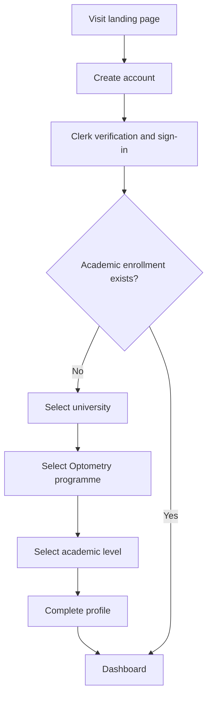
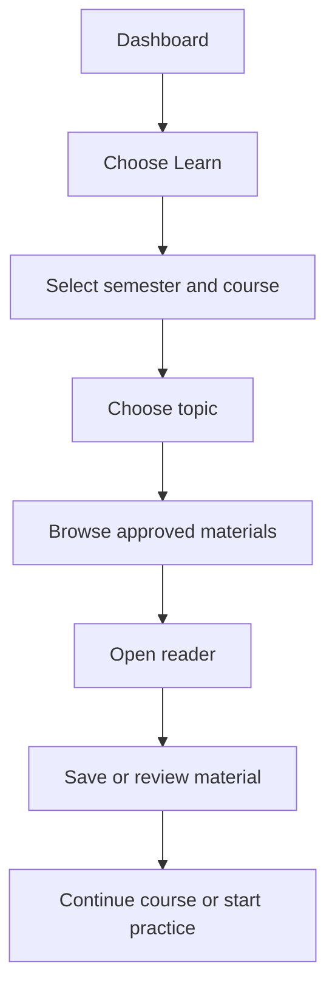
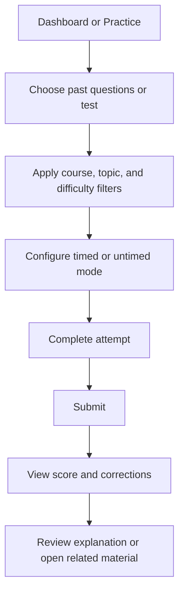
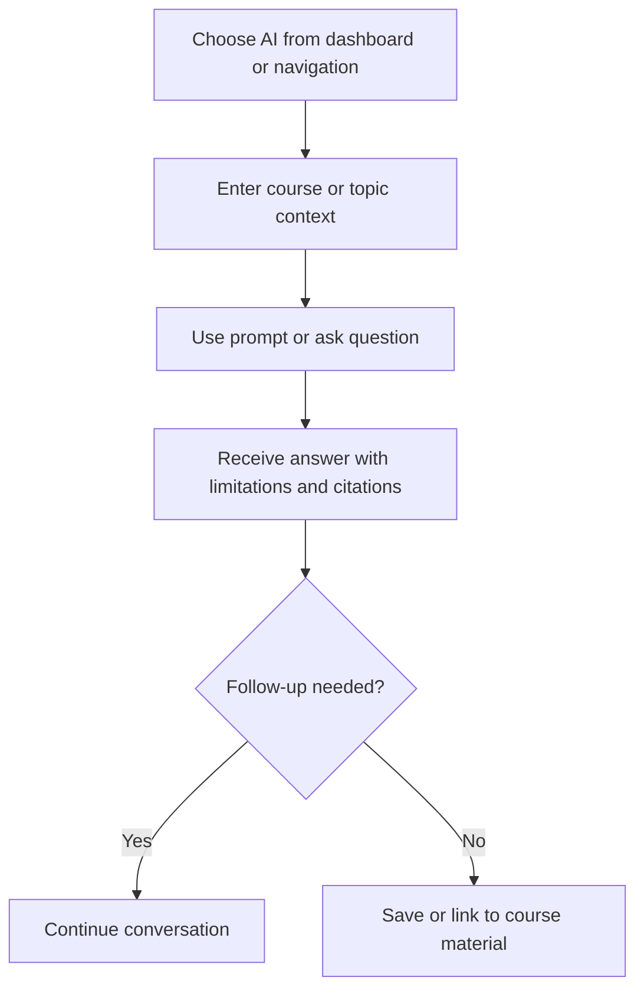
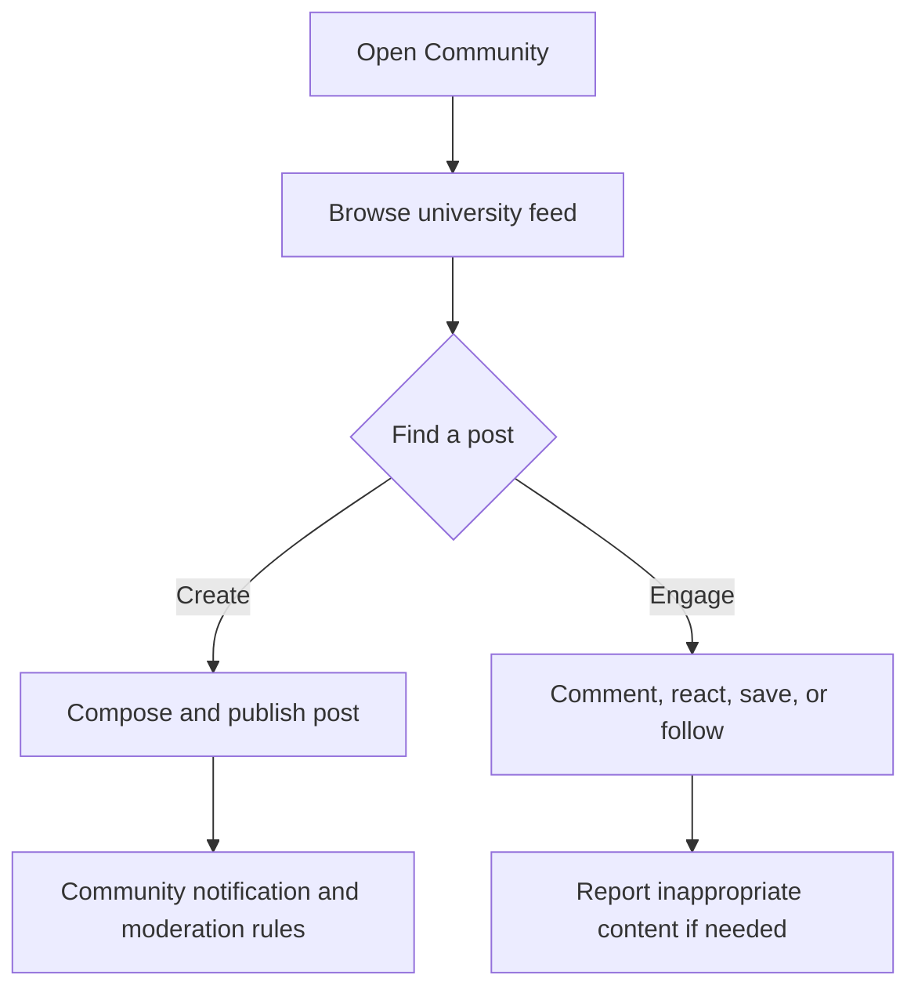
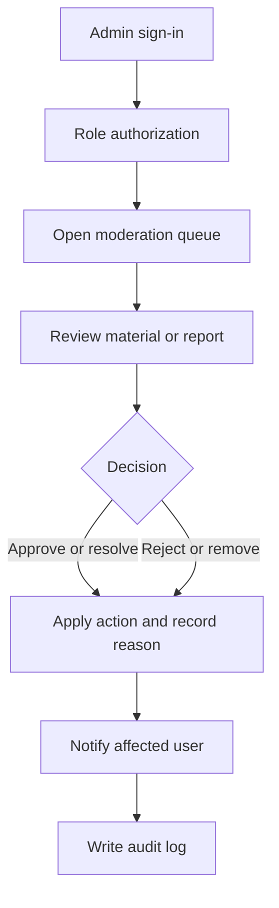

# Milestone 1 — Product and Technical Alignment

**Status:** Complete
**Scope:** Product alignment and implementation planning only; no feature implementation included.

## 1. Product Requirements Summary

### Product mission

Visora is a university-focused academic workspace for Optometry students. It combines learning resources, exam practice, AI-assisted study support, and student community features in one context-aware experience.

### Primary persona

- **Optometry student:** needs to find resources by university, programme, level, semester, course, and topic; continue learning; practice for assessments; ask academic questions; and participate in the student community.

### Supporting personas

- **Moderator:** reviews reported community content and applies moderation actions.
- **Content administrator:** manages learning materials, questions, flashcards, courses, and announcements.
- **Super administrator:** manages the complete platform, universities, academic structure, roles, audit history, and elevated moderation decisions.

### Initial roles

The Prisma role model is the source of truth:

- `STUDENT`
- `MODERATOR`
- `CONTENT_ADMIN`
- `SUPER_ADMIN`

A user may hold multiple roles. Role permissions must be checked by the API, not only hidden in the interface.

### Initial MVP priorities

1. Authentication and academic onboarding
2. Student dashboard
3. Learning materials and course navigation
4. Practice and assessment
5. Visora AI
6. Community
7. Notifications and student profile
8. Admin operations

Community and AI remain important differentiators, but learning and assessment correctness take priority over advanced conversational or social features.

## 2. Navigation and Information Architecture

### Public navigation

- `/` — product landing page
- `/login` — sign in
- `/register` — registration
- `/onboarding` — one-time academic setup

### Authenticated student navigation

- `/home` — dashboard
- `/learn` — semester, course, topic, and material discovery
- `/practice` — tests, past questions, results, and flashcards
- `/ai` — Visora AI conversations
- `/community` — social feed and discussions
- `/profile` — student and academic profile
- `/notifications` — notification center

### Intended detail routes

These routes are not yet implemented in the workspace and should be introduced in later milestones:

- `/learn/courses/[courseId]`
- `/learn/courses/[courseId]/topics/[topicId]`
- `/learn/materials/[materialId]`
- `/practice/[testId]`
- `/practice/[testId]/attempt/[attemptId]`
- `/practice/history`
- `/practice/flashcards`
- `/ai/conversations/[conversationId]`
- `/community/posts/[postId]`
- `/profile/[userId]`

### Admin navigation

The admin application should use the following separate routes:

- `/` or `/overview`
- `/universities`
- `/academic-structure`
- `/learning-materials`
- `/questions`
- `/flashcards`
- `/announcements`
- `/users`
- `/roles`
- `/community/moderation`
- `/audit-log`

## 3. Screen and Route Inventory

| Area | Route | Purpose | Milestone |
|---|---|---|---|
| Landing | `/` | Public product overview and registration entry | M1/M2 |
| Authentication | `/login` | Sign in | M3 |
| Authentication | `/register` | Account creation | M3 |
| Onboarding | `/onboarding` | University, programme, level, and profile setup | M3 |
| Dashboard | `/home` | Personalized academic overview | M4 |
| Learning | `/learn` | Semester and course browsing | M5 |
| Learning detail | `/learn/courses/[courseId]` | Course topics and progress | M5 |
| Material | `/learn/materials/[materialId]` | Reader and material actions | M5 |
| Practice | `/practice` | Practice entry points and history | M6 |
| Test | `/practice/[testId]` | Test setup | M6 |
| Attempt | `/practice/[testId]/attempt/[attemptId]` | Timed or untimed test interface | M6 |
| AI | `/ai` | Conversational study assistant | M7 |
| Community | `/community` | Feed and post composer | M8 |
| Post | `/community/posts/[postId]` | Comments and replies | M8 |
| Profile | `/profile` | Current student profile | M9 |
| Public profile | `/profile/[userId]` | Profile preview | M9 |
| Notifications | `/notifications` | Notification center | M9 |
| Admin | `/overview` | Platform health and moderation overview | M10 |
| Admin | `/universities`, `/academic-structure` | Academic hierarchy management | M10 |
| Admin | `/learning-materials`, `/questions`, `/flashcards` | Content management | M10 |
| Admin | `/community/moderation` | Reports and moderation queue | M10 |
| Admin | `/users`, `/roles`, `/audit-log` | Identity, permissions, and audit | M10 |

## 4. Core User-Flow Diagrams

### Registration and onboarding

### Learning journey

### Practice journey

### AI journey

### Community journey

### Admin moderation journey

## 5. Authentication and Onboarding Behavior

### Confirmed behavior

- Clerk will manage registration, sign-in, session, password reset, and account lifecycle.
- The local database stores the Clerk user ID, profile, enrolment, and application roles.
- Registration creates a local user record through an authenticated API provisioning flow.
- Students must complete academic onboarding before access to student-only features.
- Existing users without onboarding are redirected to `/onboarding`.
- Existing users with onboarding are redirected to `/home`.
- Returning users without an active student enrolment are blocked from student routes and returned to onboarding or an account status screen.
- The API must enforce role and enrolment access for every protected operation.
- Logout returns the user to `/login` or `/` according to the session policy.

### Onboarding fields

Required:

- University
- Optometry programme
- Academic level
- First name and last name

Recommended:

- Display name
- Profile photo
- Phone number

Matriculation number may be collected or remain optional according to university policy.

## 6. Product and Technical Priorities

### Implementation order

1. Authentication, session provisioning, and onboarding
2. Database migrations and academic seed data
3. Student dashboard
4. Learning navigation and material reader
5. Practice overview, test attempts, corrections, and history
6. Community baseline
7. AI baseline
8. Notifications and profile
9. Admin platform
10. Integration, accessibility, testing, security, and deployment

### First-page implementation priority

1. `/login`
2. `/register`
3. `/onboarding`
4. `/home`
5. `/learn`
6. `/practice`
7. `/ai`
8. `/community`
9. `/profile`
10. `/notifications`
11. `/` landing page refinements

The dashboard and learning routes may use real UI prototypes first, while authentication, persisted data, and API contracts are integrated.

## 7. Prisma Readiness Review

### Ready for implementation

- User and Clerk identity
- User roles
- Student profiles and enrolments
- Universities, programmes, levels, semesters, courses, and offerings
- Topics and learning materials
- Material moderation history
- Questions, options, tests, attempts, answers, and selected options
- Community posts, media, comments, reactions, saves, follows, and reports
- Notifications and announcements
- Moderation actions and audit logs

### Implementation requirements before production

- Add and run the PostgreSQL migration before using the database.
- Add the question-scope check constraint documented in `docs/database-design.md`.
- Validate course, programme, level, semester, and university relationships in application services.
- Verify that a selected answer option belongs to the attempt's question.
- Verify that a learning material's course belongs to its programme.
- Ensure test questions belong to the test's programme and allowed university scope.
- Add flashcard models and AI conversation models when Milestones 6 and 7 begin.
- Add explicit API endpoints for course progress, saved materials, recent materials, and reminders if not derived from existing relations.
- Do not treat the seed's role creation as a complete production seed.

### Integrity conclusion

The initial Prisma model is suitable as an implementation baseline. It is ready for a first migration after the database constraint, application-level cross-record validation, and migration workflow are completed.

## 8. Confirmed Design System Direction

### Brand

- Product name: **Visora**
- Circular **V** mark with the full wordmark
- Positioning: academic clarity, not a generic social network

### Visual direction

- Academic clarity before decoration
- Premium, approachable, and deliberately spacious
- Desktop-first student application
- Responsive layouts for tablet and mobile
- Desktop sidebar and 72–74px top navigation
- Mobile bottom navigation
- Pale neutral canvas with restrained purple brand emphasis

### Foundations

- 4px spacing scale
- System sans-serif typography
- Small, medium, and large radii
- Subtle borders and understated elevation
- Semantic success, warning, danger, and information colours

### Components required in Milestone 2

- Buttons and loading states
- Inputs, labels, validation, and form layout
- Cards and badges
- Tabs and filters
- Tables and pagination
- Dialogs and confirmations
- Dropdown menus
- Toasts and persistent alerts
- Skeletons
- Empty, success, and error states

Shared tokens and asset exports must remain in `apps/web/lib/design` and `apps/web/lib/assets`; UI code should not invent route-local design values.

## 9. Milestone 1 Completion Checklist

- [x] Target personas confirmed
- [x] Initial roles confirmed
- [x] Navigation and information architecture confirmed
- [x] Core user journeys documented
- [x] Dashboard, learning, practice, AI, community, and admin priorities established
- [x] Prisma model reviewed and implementation caveats recorded
- [x] Clerk and onboarding behavior confirmed
- [x] Product requirements summarized
- [x] Screen and route inventory produced
- [x] Core flow diagrams produced
- [x] First-page implementation priority established
- [x] Design system direction confirmed

## Final Decision

**Milestone 1 is complete.** The project is aligned and ready to begin **Milestone 2 — Design system and application shell**.
